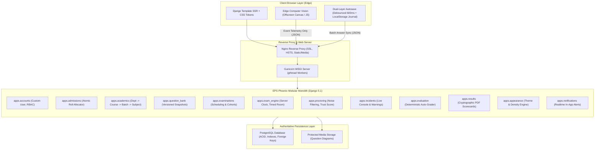

# EPS Phoenix — Architecture & Engineering Specification

## 1. High-Level Architectural Overview

**EPS Phoenix** is an enterprise-grade, institutional online examination and intelligent proctoring platform developed as a **Modular Monolithic Django Application**. It is designed to run in production under PostgreSQL and Gunicorn/Nginx, rendering server-side HTML5 via Django Templates while providing responsive, client-side progressive enhancement using Vanilla JavaScript and CSS design tokens.

### Core Architectural Principles
1. **Strictly Zero Video/Audio Recording**: In compliance with institutional privacy standards and Section 2 of the Master Requirements, continuous webcam video or audio is **never** streamed over the network or saved to disk. Computer vision runs strictly on candidate device edges (in-browser Canvas heuristics); only anonymized metadata events are transmitted to the server.
2. **Server-Authoritative Clock**: Exam timers are calculated, locked, and evaluated on the server (`expires_at`). Client-side countdowns serve purely as visual mirrors. Any API submissions post-expiry are rejected or force auto-submitted.
3. **Version Immutability via Snapshots**: Questions authored in the Question Bank lock onto immutable `QuestionSnapshot` records when assigned to examinations, guaranteeing historical integrity against retrospective alterations.
4. **Row-Level Concurrency Safety**: Monotonically increasing sequential roll number allocation and answer synchronization utilize database row-level locking (`select_for_update`) within atomic transactions to eliminate race conditions.
5. **Role-Based Isolation (RBAC)**: Strict permission boundaries isolate Student, Teacher, and Administrator workspaces. IDOR vulnerabilities are prevented through explicit ownership validation.

---

## 2. System Architecture Diagram



---

## 3. Modular Monolith Boundaries

| Application | Core Responsibility |
|---|---|
| `apps.core` | Enterprise design tokens, base layouts, custom 400/403/404/500 error pages, health checks. |
| `apps.accounts` | Custom `User` model, role hierarchy (`ADMIN`, `TEACHER`, `STUDENT`), session security, active status checks. |
| `apps.student` | Candidate registration dossier, student profile, self-service dashboard, IDOR defense. |
| `apps.teacher` | Faculty profile, department scoping, assigned course catalog, admission queue review. |
| `apps.administration` | Institutional governance settings, faculty onboarding, audit log monitoring, system status. |
| `apps.admissions` | Monotonic sequential roll number allocation with `select_for_update` row locks, admission history ledger. |
| `apps.academics` | Academic scoping tree: Department &rarr; Course &rarr; Batch &rarr; Semester &rarr; Subject &rarr; Teacher Assignment &rarr; Student Enrollment. |
| `apps.question_bank` | 8-type question bank (MCQ, True/False, Blanks, Numerical, Rubric-based) with immutable JSON snapshots. |
| `apps.examinations` | Examination scheduling, window validation, sections, candidate auto-provisioning. |
| `apps.exam_engine` | Distraction-free exam room, server-authoritative timer, dual-layer debounced autosave, submission SHA-256 receipt. |
| `apps.proctoring` | Edge AI telemetry ingestion, 1.5s blur noise filtering, dynamic candidate Trust Score computation. |
| `apps.incidents` | Live invigilator console, warning issuance, candidate time extensions, disciplinary penalty deductions. |
| `apps.evaluation` | Deterministic auto-grader for objective items, subjective grading queue with rubric scoring. |
| `apps.results` | Cohort results publication, institutional grading scale, ReportLab cryptographic PDF transcripts with SHA-256 verification. |
| `apps.notifications` | Notification dispatcher, unread badge counter, critical alert banners. |
| `apps.appearance` | ChatGPT-inspired appearance customizer (Light, Dark, System, Accent hues, High Contrast, Density) with non-FOUC cookies. |

---

## 4. Key Security & Resilience Invariants

### 4.1 Server-Authoritative Session Lifecycles
Candidates cannot manipulate exam session timers:
```python
# Server computes absolute expiry clamped to examination end window
authoritative_expiry = min(now + timedelta(minutes=total_allowed_minutes), exam.end_window)
```
Any autosave or answer submission attempted when `timezone.now() > attempt.expires_at` automatically triggers server auto-submission and rejects further persistence.

### 4.2 Race Condition Elimination in Roll Allocation
Concurrent faculty approvals for admission applications use PostgreSQL row locking on `RollSequenceCounter`:
```python
counter, _ = RollSequenceCounter.objects.select_for_update().get_or_create(
    prefix=prefix, academic_year=year
)
counter.current_sequence += 1
counter.save(update_fields=["current_sequence", "updated_at"])
```
This guarantees strictly consecutive, collision-free roll numbers across concurrent threads.

### 4.3 Answer Key Leakage Prevention
Active examination question delivery utilizes `get_student_safe_snapshot_data(snapshot)` which sanitizes payload dictionaries, permanently stripping:
- `is_correct` flags on option choices
- Teacher `explanation` notes
- Model solutions and rubrics
- Numerical target values and tolerance bands
